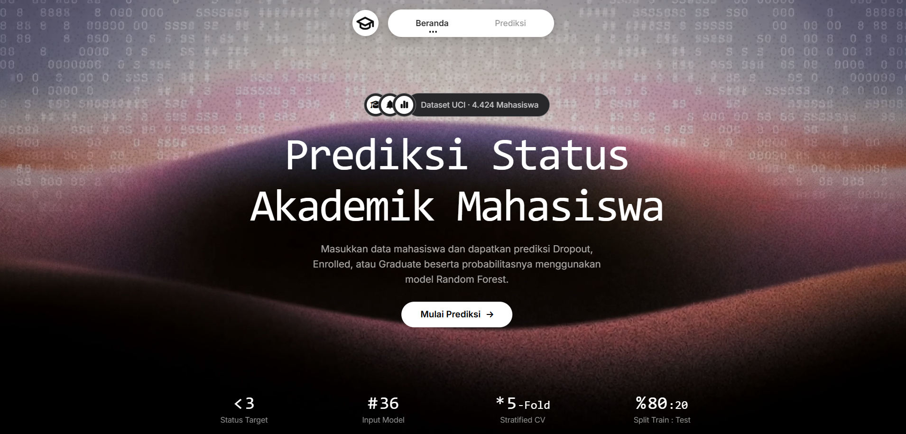

# Early Warning System Prediksi Status Akademik Mahasiswa
### Klasifikasi Multi-Kelas (*Dropout*, *Enrolled*, *Graduate*) Menggunakan Random Forest Ensemble, SMOTENC Balancing, RESTful API, dan Antarmuka Interaktif Berbasis Desain Stitch

---

<p align="center">
  
</p>

---

## 📌 Identitas Proyek

- **Jenis Penugasan:** **Tugas Individu** (Independent Data Science & Machine Learning Capstone Project)
- **Mata Kuliah:** Proyek Sains Data
- **Semester:** 5 (Tahun Akademik 2024/2025)
- **Topik:** *End-to-End Machine Learning System for Academic Attrition Risk Detection*
- **Peran Pengembang:** Full-Cycle Machine Learning Engineer (Data Preprocessing, Anti-Leakage Pipeline Architecture, Model Experimentation & Hyperparameter Tuning, RESTful API Development, Responsive UI/UX Conversion, Automated Contract Testing, and Technical Documentation).

---

## 🎯 Ringkasan Eksekutif & Latar Belakang

Retensi mahasiswa merupakan indikator vital dalam keberhasilan tata kelola institusi pendidikan tinggi. Fenomena putus studi (*dropout*) tidak hanya mengakibatkan kerugian finansial dan hilangnya potensi pendapatan bagi perguruan tinggi, namun juga menimbulkan dampak psikososial dan ekonomi yang signifikan bagi mahasiswa. Kendala mendasar pada operasional akademik konvensional adalah **keterlambatan deteksi dini**; pihak program studi dan dosen wali sering kali baru menyadari kegagalan akademik ketika mahasiswa telah menumpuk tunggakan sks dan berada di ambang batas waktu studi.

Proyek ini menghadirkan solusi komprehensif berupa **Sistem Peringatan Dini (*Early Warning System*)** berbasis *Machine Learning* yang mampu mengklasifikasikan status akademik mahasiswa secara dini ke dalam **3 kelas**:
1. **Graduate:** Mahasiswa yang diprediksi menyelesaikan studi tepat waktu dengan performa akademik yang memadai.
2. **Dropout:** Mahasiswa yang berisiko tinggi putus studi atau mengundurkan diri di tengah jalan.
3. **Enrolled:** Mahasiswa yang masih aktif terdaftar namun berada pada fase kritis/ambigu, sehingga memerlukan pemantauan ketat dan pendampingan akademik intensif.

Seluruh arsitektur dibangun dengan standar rekayasa perangkat lunak profesional: modular, dapat direproduksi (*reproducible*), bebas dari kebocoran data (*zero data leakage*), tervalidasi secara otomatis melalui *unit testing*, serta disajikan dalam antarmuka web modern (*Single Page Application*) yang elegan dan responsif.

---

## 📊 Dataset & Validasi Integritas Data

- **Sumber Resmi:** [UCI Machine Learning Repository — "Predict Students' Dropout and Academic Success"](https://archive.ics.uci.edu/dataset/697/predict+students+dropout+and+academic+success) (Realinho et al., 2021).
- **Dimensi Data:** 4.424 baris data mahasiswa × 37 kolom (36 fitur prediktor + 1 kolom target `Target`).
- **Integritas Data:** 
  - Tidak ditemukan nilai kosong (*0 missing values*).
  - Tidak terdapat baris duplikat (*0 duplicate rows*).
  - Menggunakan model berbasis pohon (*Random Forest*) yang secara inheren tangguh terhadap pencilan (*outliers*) tanpa rekayasa *clipping* atau pembuangan sampel yang tidak berdasar.
- **Distribusi Kelas Target (Kondisi Imbalance Alami):**
  - **Graduate:** 2.209 mahasiswa (**49.93%**) — *Kelas Mayoritas*
  - **Dropout:** 1.421 mahasiswa (**32.12%**) — *Kelas Menengah*
  - **Enrolled:** 794 mahasiswa (**17.95%**) — *Kelas Minoritas Kritis*

### Taksonomi 36 Fitur Input (Grup Domain):
1. **Demografi (7 fitur):** Status perkawinan (`marital_status`), jenis kelamin (`gender`), usia saat pendaftaran (`age_at_enrollment`), kewarganegaraan (`nationality`), status mahasiswa internasional (`international`), status merantau (`displaced`), kebutuhan khusus pendidikan (`educational_special_needs`).
2. **Jalur Pendaftaran (7 fitur):** Jalur masuk (`application_mode`), urutan prioritas pilihan prodi (`application_order`), program studi (`course`), waktu kuliah siang/malam (`daytime_evening_attendance`), jenjang pendidikan sebelumnya (`previous_qualification`), nilai pendidikan sebelumnya (`previous_qualification_grade`), nilai tes masuk (`admission_grade`).
3. **Sosial-Ekonomi & Finansial (7 fitur):** Pendidikan ayah & ibu (`fathers_qualification`, `mothers_qualification`), pekerjaan ayah & ibu (`fathers_occupation`, `mothers_occupation`), status penunggak pembayaran (`debtor`), kelancaran pembayaran UKT/SPP (`tuition_fees_up_to_date`), penerima beasiswa (`scholarship_holder`).
4. **Akademik Semester 1 (6 fitur):** SKS diakui (`cu_1st_credited`), SKS diambil (`cu_1st_enrolled`), evaluasi ujian (`cu_1st_evaluations`), SKS lulus (`cu_1st_approved`), rata-rata nilai (`cu_1st_grade`), SKS tanpa evaluasi (`cu_1st_without_evaluations`).
5. **Akademik Semester 2 (6 fitur):** SKS diakui (`cu_2nd_credited`), SKS diambil (`cu_2nd_enrolled`), evaluasi ujian (`cu_2nd_evaluations`), SKS lulus (`cu_2nd_approved`), rata-rata nilai (`cu_2nd_grade`), SKS tanpa evaluasi (`cu_2nd_without_evaluations`).
6. **Konteks Makroekonomi (3 fitur):** Tingkat pengangguran wilayah (`unemployment_rate`), tingkat inflasi (`inflation_rate`), dan pertumbuhan GDP (`gdp`).

---

## ⚙️ Metodologi Eksperimen & Desain Anti-Kebocoran Data (*Anti-Data Leakage*)

Untuk menjamin reliabilitas dan validitas akademik tingkat tinggi, eksperimen dirancang dengan disiplin *anti-data leakage* yang ketat:

```
                            [ Raw Dataset: 4,424 Sampel ]
                                          │
                     ┌────────────────────┴────────────────────┐
                     ▼                                         ▼
           [ Training Set (80%) ]                     [ Test Set (20%) ]
              3,539 Sampel                               885 Sampel
                     │                                         │
       5-Fold Stratified Cross-Validation                      │
  ┌──────────────────┴──────────────────┐                      │
  ▼                                     ▼                      │
[ Train Folds (80%) ]         [ Val Fold (20%) ]               │
  │                             │                              │
  ├─ ColumnTransformer (Fit)    │                              │
  ├─ SMOTENC (Fit & Resample)   │                              │
  └─ Random Forest (Fit)        │                              │
        │                       │                              │
        └───────► Predict ──────┴─► Evaluasi Validasi          │
                                                               │
  [ Pipeline Final: Preprocessing + Random Forest ]            │
  (SMOTENC Dihilangkan pada Tahap Inferensi)                   │
                     │                                         │
                     └─────────────────► Evaluasi Hold-Out ◄───┘
```

1. **Pemisahan Data di Hulu (Stratified 80:20 Split):** Dataset dipartisi menggunakan `stratify=y` dan `random_state=42`. Sebanyak 885 sampel data uji diisolasi sepenuhnya dan tidak pernah disentuh dalam proses pelatihan maupun penalaan hyperparameter.
2. **Cross-Validation Terstrata 5-Lipat (5-Fold Stratified CV):** Digunakan pada data latih (3.539 baris) untuk memvalidasi performa model secara objektif pada setiap iterasi.
3. **Resampling SMOTENC di Dalam Pipeline (`imblearn`):** Penanganan ketimpangan kelas menggunakan SMOTENC (*Synthetic Minority Over-sampling Technique for Nominal and Continuous*). Algoritma ini dimasukkan ke dalam pipeline sehingga **hanya aktif meregenerasi data pada fold pelatihan**, tanpa mencemari fold validasi maupun test set.
4. **Pembersihan Resampling Saat Produksi:** Pipeline inferensi yang diekspor ke [models/rf_pipeline.joblib](file:///d:/Backup%20Data%20C/Downloads/Documents/Semester%205/Proyek%20Sains%20Data/Tugas/UAS/ML-Project--Student-Dropout-Prediction--main/models/rf_pipeline.joblib) murni terdiri dari komponen deterministik `prep` (`ColumnTransformer`) dan `rf` (`RandomForestClassifier`), tanpa overhead atau ketidakpastian proses sintetis saat inferensi.

---

## 🔬 Hasil Eksperimen & Analisis Kinerja Model

Empat skenario eksperimen dievaluasi secara terukur:
- **E1:** Random Forest Baseline (default parameter, tanpa balancing).
- **E2:** Random Forest dengan pembobotan biaya (`class_weight='balanced'`).
- **E3:** Random Forest dengan penyeimbangan data sintetis `SMOTENC` di dalam pipeline.
- **E4:** Tuned Random Forest (optimasi `n_estimators`, `max_depth`, `min_samples_split`, `min_samples_leaf`, dan `max_features` via `RandomizedSearchCV` 40 iterasi berarah `f1_macro`).

### Tabel Evaluasi Komparatif pada Hold-out Test Set (885 Sampel):

| Skenario Eksperimen | Akurasi | Balanced Accuracy | Macro F1 | Recall Dropout | Recall Enrolled | Recall Graduate | Status Model |
|---|:---:|:---:|:---:|:---:|:---:|:---:|:---:|
| **E1 Baseline** | **77.51%** | 68.50% | 0.6972 | 75.35% | 36.48% | **93.67%** | Acuan Awal |
| **E2 Class-Weighted** | 77.18% | 68.00% | 0.6904 | **76.41%** | 34.59% | 92.99% | Alternatif Bobot |
| **E3 SMOTENC Pipeline** | 75.82% | 70.39% | **0.7051** | 72.54% | 52.20% | 86.43% | Eksperimen Balancing |
| **E4 Tuned SMOTENC** | 74.12% | **70.54%** | **0.6994** | 68.66% | **60.38%** | 82.58% | **Model Produksi Terpilih** |

### 💡 Analisis Signifikansi Klinis pada Kelas Minoritas (*Enrolled*):
Pada konteks sistem peringatan dini akademik, metrik **Recall kelas Enrolled** adalah indikator paling krusial. Model baseline (E1) mengalami kegagalan deteksi pada mahasiswa enrolled dengan hanya mendeteksi **36.48%** (lebih dari 63% mahasiswa rentan tidak terdeteksi). Melalui penerapan SMOTENC dan penalaan parameter pada model E4, recall mahasiswa rentan melesat naik hingga **60.38% (+23.90% peningkatan absolut)** dengan Balanced Accuracy tertinggi (**70.54%**). Peningkatan ini memastikan sistem berhasil menjalankan fungsinya sebagai detektor dini risiko akademik.

### 🌟 Fitur Paling Berpengaruh (*Feature Importance*):
Berdasarkan pengujian gabungan *Mean Decrease in Impurity* (MDI) dan *Permutation Feature Importance* pada data uji:
1. **`cu_2nd_approved` & `cu_1st_approved`:** Jumlah SKS yang berhasil diluluskan pada tahun pertama adalah prediktor determinan utama keberhasilan studi.
2. **`cu_2nd_grade` & `cu_1st_grade`:** Capaian indeks prestasi semester awal memberikan sinyal kuat terhadap daya adaptasi akademik mahasiswa.
3. **`tuition_fees_up_to_date`:** Kelancaran finansial; mahasiswa dengan tunggakan biaya kuliah memiliki korelasi sangat tinggi terhadap kejadian *dropout*.
4. **`scholarship_holder`:** Kepemilikan beasiswa berperan sebagai faktor protektif yang signifikan terhadap retensi studi.
5. **`age_at_enrollment`:** Usia saat mendaftar; mahasiswa dewasa (*mature students*) menghadapi tantangan waktu dan beban kerja yang lebih kompleks.

---

## 💻 Aplikasi Web & Antarmuka Interaktif (Desain Stitch)

Aplikasi dibangun sebagai *Single Page Application* (SPA) modern yang mengimplementasikan rancangan visual profesional dari Stitch:

- **Formulir Bertahap Interaktif (Wizard 4 Kategori / 6 Langkah):** Membimbing pengguna mengisi data secara logis (Akademik, Sosio-Ekonomi, Pendaftaran, Demografi, Makroekonomi) dengan validasi real-time.
- **Tombol Preset Instan (1-Click Demo):** 
  - *Mahasiswa Lulus:* Simulasi profil mahasiswa teladan (SKS tuntas, IP > 13.5, UKT lancar).
  - *Mahasiswa Dropout:* Simulasi profil mahasiswa kritis (0 SKS semester 2, menunggak UKT).
  - *Mahasiswa Aktif:* Simulasi profil mahasiswa pada zona rentan (SKS lulus sebagian, perlu pemantauan).
- **Pengisian Nilai Median Makroekonomi Otomatis:** Memungkinkan pengisian instan angka rata-rata nasional untuk tingkat pengangguran (11.1%), inflasi (1.4%), dan GDP (0.32%).
- **Visualisasi Animasi Random Forest Voting:** Menampilkan matriks 24 pohon keputusan individual yang berkelap-kelip dan mewarnai dirinya secara dinamis sesuai perolehan suara terbanyak (*majority vote*).
- **Bilah Probabilitas Dinamis & Efek Scramble Text:** Menyajikan visualisasi persentase keyakinan model secara transparan untuk ketiga kelas (*Graduate*, *Enrolled*, *Dropout*) beserta panduan rekomendasi intervensi terarah.

---

## 📁 Struktur Repositori Terstandarisasi

Struktur direktori disusun rapi, bersih, dan mematuhi konvensi *best practice* sains data:

```
ML-Project--Student-Dropout-Prediction--main/
├── app/
│   ├── static/
│   │   ├── data/
│   │   │   └── labels.json                    # Kamus metadata & opsi 36 fitur bahasa Indonesia
│   │   └── index.html                         # Single Page Application (desain Stitch)
│   ├── __init__.py
│   ├── main.py                                # Server Flask REST API (endpoints: /, /predict, /api/schema, /health)
│   └── predictor.py                           # Modul validasi kontrak skema, koersi tipe data, & inferensi
├── Data/
│   └── data.csv                               # Dataset primer UCI Machine Learning Repository
├── Docs/
│   ├── referensi_desain_stitch/               # Arsip 9 file mockup HTML & aset visual desain Stitch asli
│   │   ├── Prediksi Status Akademik Mahasiswa(Halaman Depan).html.html
│   │   ├── Web.png                            # Screenshot tampilan antarmuka web sistem
│   │   └── ... (file mockup tahapan wizard)
│   ├── 20_Sampel_Mahasiswa.csv                # Ekstrak 20 data mahasiswa untuk audit simulasi
│   ├── Laporan_Ringkas_Proyek.md              # Laporan teknis metodologi, protokol anti-leakage, & evaluasi
│   ├── Simulasi_Majority_Voting_20_Sampel.csv # Hasil tabulasi pemungutan suara 3 pohon keputusan
│   └── Workbook_Simulasi_Random_Forest_20_Sampel.md # Panduan perhitungan manual Gini Impurity & Voting
├── models/
│   ├── features.json                          # Kontrak resmi 36 fitur, valid bounds, tipe, & grup
│   ├── model_info.json                        # Metadata konfigurasi, parameter terbaik, & metrik model E4
│   ├── rf_pipeline.joblib                     # Serialized scikit-learn pipeline siap inferensi
│   └── split_indices.json                     # Indeks pemisahan data latih & uji (80:20 terstrata)
├── Notebook/
│   ├── 01_eda.ipynb                           # Analisis data eksploratif, distribusi target, & uji ANOVA
│   ├── 02_preprocessing_experiment.ipynb      # Eksplorasi pembersihan data & pengujian fitur
│   ├── 03_rf_modeling_tuning.ipynb            # Eksperimen pemodelan awal Random Forest
│   ├── 04_uas_rf_pipeline_utama.ipynb         # Notebook resmi UAS: eksekusi pipeline lengkap E1–E4
│   └── arsip_eksplorasi_lama/                 # Arsip eksperimen pembanding tambahan
├── reports/
│   ├── figures/                               # Matriks konfusi counts & normalisasi E1–E4, plot Feature Importance
│   └── metrics/                               # Rekapitulasi metrik CV, tuning RandomizedSearch, dan hold-out test
├── src/
│   ├── __init__.py
│   ├── config.py                              # Pengaturan sentral path, hyperparameter, SEED=42, target classes
│   ├── data.py                                # Fungsi pemuatan dataset, verifikasi integritas, & metadata
│   ├── evaluate.py                            # Komputasi metrik evaluasi, confusion matrix, & MDI/Permutation importance
│   ├── export.py                              # Ekspor pipeline final & sinkronisasi kontrak features.json
│   ├── generate_notebook.py                   # Generator otomatis untuk notebook 04
│   ├── generate_simulation.py                 # Komputasi otomatis simulasi manual 20 sampel & Gini index
│   ├── labels.py                              # Pemetaan resmi deskripsi bahasa Indonesia untuk 36 fitur UCI
│   ├── pipeline.py                            # Pabrik pembuatan Pipeline ColumnTransformer & SMOTENC
│   ├── run_importance.py                      # Skrip eksekusi analisis Feature Importance
│   ├── schema.py                              # Definisi kolom fitur nominal, biner, numerik, dan grup
│   └── train.py                               # Engine pelatihan model E1–E4 dengan 5-Fold Stratified CV
├── tests/
│   ├── __init__.py
│   └── test_contract.py                       # Pengujian otomatis: skema, anti-resampling, validasi bound, & paritas
├── .gitignore                                 # Konfigurasi pengabaian file cache, build, dan artefak OS
├── Dockerfile                                 # Definisi kontainerisasi Docker untuk deployment lingkungan terisolasi
├── plan.md                                    # Panduan dan rubrik pengerjaan tugas proyek
├── Procfile                                   # Konfigurasi deployment server cloud (Heroku, Render, Railway)
├── README.md                                  # Dokumentasi teknis komprehensif repositori proyek
└── requirements.txt                           # Daftar pustaka dan dependensi Python
```

---

## 🚀 Panduan Instalasi & Menjalankan Proyek

### 1. Prasyarat Lingkungan
- Python versi `3.10` atau lebih baru (`3.11` / `3.12` / `3.14` didukung penuh).
- Disarankan menggunakan virtual environment terisolasi.

### 2. Kloning & Instalasi Dependensi
```bash
# Masuk ke direktori proyek
cd ML-Project--Student-Dropout-Prediction--main

# Buat dan aktifkan virtual environment (opsional namun disarankan)
python -m venv venv
# Windows:
venv\Scripts\activate
# Linux/macOS:
source venv/bin/activate

# Install seluruh pustaka yang diperlukan
pip install -r requirements.txt
```

### 3. Menjalankan Pengujian Otomatis (*Automated Test Suite*)
Seluruh integritas kontrak model, validasi data masukan, uji paritas, dan jaminan non-resampling diverifikasi melalui *pytest*:
```bash
python -m pytest tests
```
*Status: 7 dari 7 pengujian tuntas 100% lulus dalam ~9 detik.*

### 4. Menjalankan Server Web Interaktif (Flask)
```bash
python -m app.main
```
Akses aplikasi melalui peramban web pada alamat:
👉 **`http://127.0.0.1:5000`**

### 5. Menjalankan Melalui Kontainer Docker
```bash
# Membangun docker image
docker build -t student-dropout-system .

# Menjalankan kontainer pada port 5000
docker run -p 5000:5000 student-dropout-system
```

---

## 📡 Dokumentasi Antarmuka Pemrograman Aplikasi (REST API)

Sistem menyediakan antarmuka API yang dapat diintegrasikan dengan Sistem Informasi Akademik (SIAKAD) kampus:

### 1. Cek Kesiapan Model (`GET /health`)
- **Deskripsi:** Memeriksa kesiapan pipeline inferensi.
- **Respons (200 OK):**
  ```json
  { "status": "ok" }
  ```

### 2. Pengambilan Kontrak Skema Fitur (`GET /api/schema`)
- **Deskripsi:** Mengembalikan daftar lengkap 36 fitur, tipe data, rentang nilai valid, opsi kategori, grup domain, dan label bahasa Indonesia.

### 3. Prediksi Status Akademik (`POST /predict`)
- **Headers:** `Content-Type: application/json`
- **Payload:**
  ```json
  {
    "features": {
      "marital_status": "1",
      "application_mode": "1",
      "application_order": 1,
      "course": "9254",
      "daytime_evening_attendance": "1",
      "previous_qualification": "1",
      "previous_qualification_grade": 140.0,
      "nationality": "1",
      "mothers_qualification": "1",
      "fathers_qualification": "1",
      "mothers_occupation": "5",
      "fathers_occupation": "5",
      "admission_grade": 130.0,
      "displaced": "1",
      "educational_special_needs": "0",
      "debtor": "0",
      "tuition_fees_up_to_date": "1",
      "gender": "0",
      "scholarship_holder": "1",
      "age_at_enrollment": 19,
      "international": "0",
      "cu_1st_credited": 0,
      "cu_1st_enrolled": 6,
      "cu_1st_evaluations": 6,
      "cu_1st_approved": 6,
      "cu_1st_grade": 14.5,
      "cu_1st_without_evaluations": 0,
      "cu_2nd_credited": 0,
      "cu_2nd_enrolled": 6,
      "cu_2nd_evaluations": 6,
      "cu_2nd_approved": 6,
      "cu_2nd_grade": 14.8,
      "cu_2nd_without_evaluations": 0,
      "unemployment_rate": 11.1,
      "inflation_rate": 1.4,
      "gdp": 0.32
    }
  }
  ```
- **Respons (200 OK):**
  ```json
  {
    "prediction": "Graduate",
    "probabilities": {
      "Dropout": 0.052,
      "Enrolled": 0.118,
      "Graduate": 0.830
    },
    "risk_level": "Rendah",
    "description": "Mahasiswa menunjukkan profil akademik yang sangat sehat dan berpeluang tinggi untuk lulus tepat waktu."
  }
  ```

---

## 📖 Artefak Dokumen Akademik & Simulasi Manual

Untuk melengkapi transparansi metodologis dalam ujian akhir semester, disediakan dokumen pendukung di direktori `Docs/`:
1. [Laporan_Ringkas_Proyek.md](file:///d:/Backup%20Data%20C/Downloads/Documents/Semester%205/Proyek%20Sains%20Data/Tugas/UAS/ML-Project--Student-Dropout-Prediction--main/Docs/Laporan_Ringkas_Proyek.md): Laporan terperinci mengenai perumusan masalah, protokol anti-kebocoran data, hasil pengujian eksperimen E1–E4, dan analisis metrik.
2. [Workbook_Simulasi_Random_Forest_20_Sampel.md](file:///d:/Backup%20Data%20C/Downloads/Documents/Semester%205/Proyek%20Sains%20Data/Tugas/UAS/ML-Project--Student-Dropout-Prediction--main/Docs/Workbook_Simulasi_Random_Forest_20_Sampel.md): Dokumentasi simulasi manual matematis algoritma Random Forest pada 20 sampel data mahasiswa, meliputi pembentukan *bootstrap samples*, seleksi *feature subspace*, penurunan *Gini Impurity*, serta mekanisme *Majority Voting*.
3. [20_Sampel_Mahasiswa.csv](file:///d:/Backup%20Data%20C/Downloads/Documents/Semester%205/Proyek%20Sains%20Data/Tugas/UAS/ML-Project--Student-Dropout-Prediction--main/Docs/20_Sampel_Mahasiswa.csv) & [Simulasi_Majority_Voting_20_Sampel.csv](file:///d:/Backup%20Data%20C/Downloads/Documents/Semester%205/Proyek%20Sains%20Data/Tugas/UAS/ML-Project--Student-Dropout-Prediction--main/Docs/Simulasi_Majority_Voting_20_Sampel.csv): Data tabulasi numerik hasil audit simulasi manual.

---

## ⚖️ Etika Penggunaan & Batasan Sistem (*Ethical Disclaimer*)

Sistem kecerdasan buatan ini dikembangkan secara spesifik dengan tujuan sebagai **Sistem Pendukung Keputusan dan Peringatan Dini (*Early Warning & Advisory System*)**. Prediksi dan probabilitas yang dihasilkan ditujukan untuk membantu dosen pembimbing akademik dan pimpinan program studi dalam merancang program bimbingan, konseling, atau pemberian bantuan finansial secara proaktif, **bukan** sebagai landasan otomatisasi pemberian sanksi akademik, pemutusan beasiswa, atau pemberhentian studi sepihak tanpa evaluasi manusiawi mendalam.
